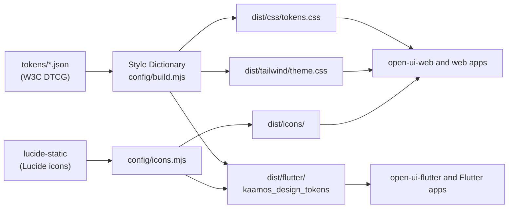

# Kaamos design tokens wiki

`open-design-tokens` is the **single source** of the Kaamos design system's tokens (colours, typography, spacing, radii, motion) and shared assets (the Inter font, icons). From it a build generates the web version (CSS variables, Tailwind v4 theme) and the Flutter version (a Dart package).

## Pages

| Page | What you will find |
|---|---|
| [Getting started](getting-started.md) | Install, build, the checks CI runs, repo layout |
| [Token format](token-format.md) | DTCG files, categories, aliases, units, the custom `fontFeatures` kind |
| [Build pipeline](build-pipeline.md) | How Style Dictionary and the custom formats turn tokens into CSS, Tailwind and Dart |
| [Icons](icons.md) | The Lucide set: icon font and `KaamosIcons` for Flutter, modules and sprite for the web, tree-shaking, updating Lucide |
| [Using the tokens](using-tokens.md) | From npm (CSS, Tailwind) and from git (Flutter) |
| [Releases](releases.md) | The manual release workflow, the `release` branch, npm Trusted Publishing |
| [Decisions](decisions.md) | The key choices and their trade-offs |

## Writing these pages

- One page per topic, in English, linked with relative links only.
- Every page starts with a `[Home](README.md) › Page` breadcrumb and ends with "See also".
- A pull request that changes behaviour also updates the page that describes it.
