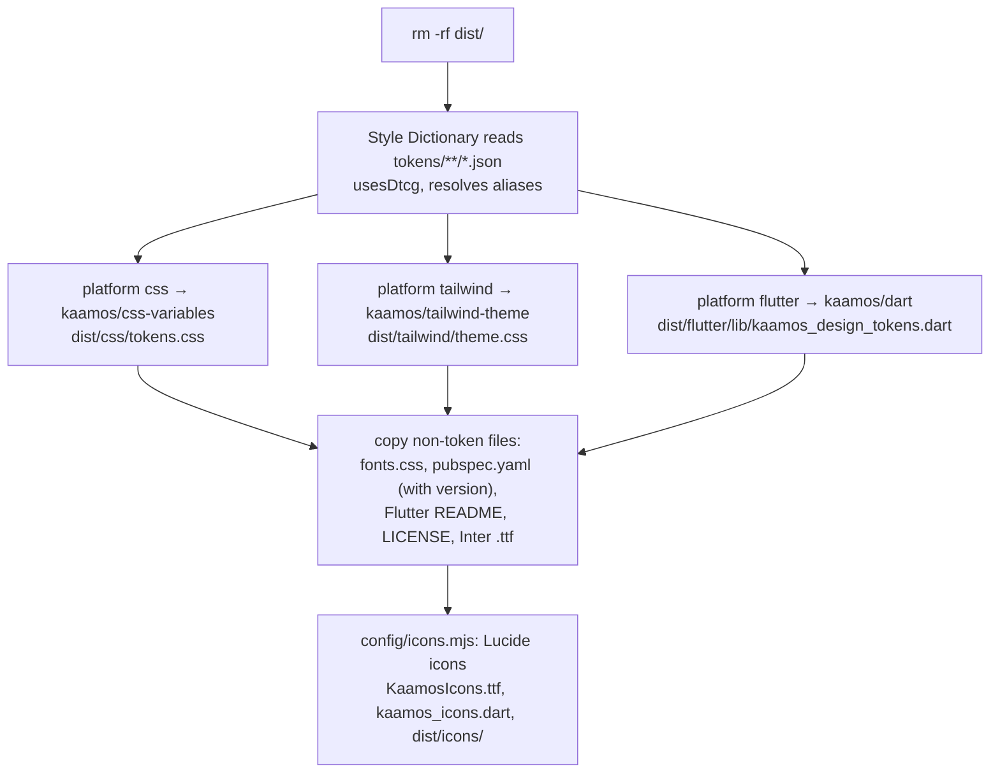

[Home](README.md) › Build pipeline

# Build pipeline

`npm run build` runs `config/build.mjs`. It uses [Style Dictionary](https://styledictionary.com) (pinned to `5.8.0`) to read the tokens and three **custom formats** to write them.



## Output

| File | For |
|---|---|
| `dist/css/tokens.css` | CSS variables in `:root`, for the web without Tailwind |
| `dist/css/fonts.css` | `@font-face` for Inter (copied from `config/templates/fonts.css`) |
| `dist/tailwind/theme.css` | Tailwind v4 `@theme` block: generates classes (`bg-canvas`, `text-body-md`…) and variables |
| `dist/flutter/` | The complete Dart package `kaamos_design_tokens`: `pubspec.yaml`, `lib/` (tokens and `kaamos_icons.dart`), fonts (Inter and `KaamosIcons.ttf`), licenses |
| `dist/icons/` | Lucide icons for the web: `index.js` (+ `.d.ts`), `sprite.svg`, `icons.json`, license. See [Icons](icons.md) |

## Strict by design

```js
log: { warnings: "error", verbosity: "verbose" }
```

A warning (an alias to a missing token, two tokens with the same name) becomes an **error**, so CI fails instead of printing a line nobody reads.

Every platform uses the `name/kebab` transform: a token's internal name is its full path (`font.weight.normal` → `font-weight-normal`). Without it Style Dictionary would use only the last key, and `normal` would exist twice. The final names are decided by the formats.

## The formats (`config/formats/`)

| File | What it does |
|---|---|
| `shared.mjs` | `cssVariables()`: maps every token to `[css name, value]` following Tailwind namespaces; px → rem; font families, font features, cubic-bezier; the "GENERATED" header |
| `css.mjs` | `kaamos/css-variables` (a `:root` block) and `kaamos/tailwind-theme` (an `@theme` block) |
| `dart.mjs` | `kaamos/dart`: one `abstract final class` per category, colours as `Color(0xAARRGGBB)`, px as `double`, `TextStyle`s that use the bundled Inter font |

The Tailwind theme starts with `--color-*: initial;` and `--radius-*: initial;`: Tailwind's default palette and radii are removed, because a design system uses only its official tokens.

In `typography`, Tailwind v4 lets `--text-*` carry line height, letter spacing and weight, so the `text-body-md` class applies the whole style at once.

## Fonts

Flutter can't read `.woff2`, so `assets/fonts/` holds Inter both as `.woff2` (web, in the npm package) and `.ttf` (copied into the Flutter package).

## Icons

Icons aren't tokens, so Style Dictionary doesn't see them: after the token build, `buildIcons()` in `config/icons.mjs` reads `lucide-static` and writes the icon font, the Dart class and the web files. See [Icons](icons.md).

## See also

- [Icons](icons.md)
- [Token format](token-format.md)
- [Using the tokens](using-tokens.md)
- [Decisions](decisions.md#style-dictionary-with-custom-formats)
