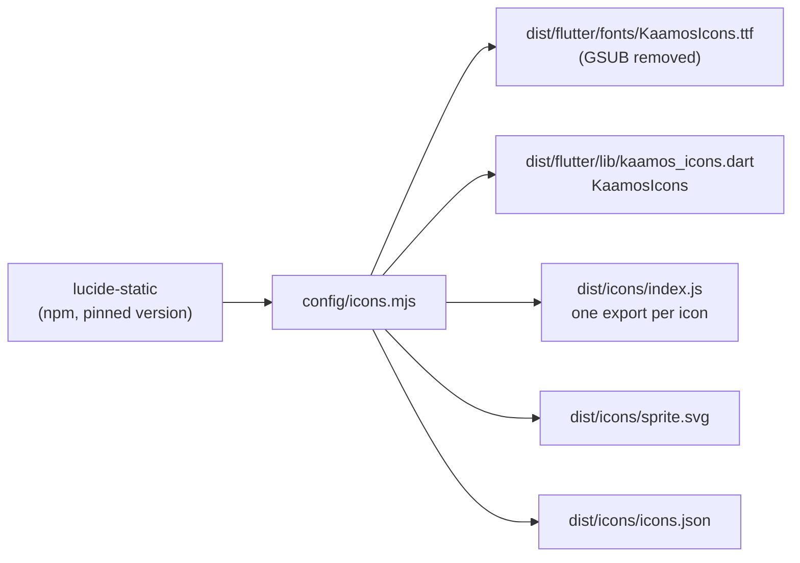

[Home](README.md) › Icons

# Icons

Kaamos uses the **full [Lucide](https://lucide.dev) set**: 2,140 icons (Lucide 1.83.0), drawn on a 24×24 grid with a 2px stroke, rounded caps and joins. This repo turns them into an icon font for Flutter and tree-shakeable modules for the web.



## Where the icons come from

The source is the [`lucide-static`](https://www.npmjs.com/package/lucide-static) npm package, a dev dependency pinned to an exact version in `package.json`. We don't copy the SVGs into this repo: the version number is the whole "source", and updating means changing it (see [Updating Lucide](#updating-lucide)).

From that package the build reads:

| File | What we take |
|---|---|
| `icon-nodes.json` | The canonical icon names and their SVG content |
| `font/lucide.ttf`, `font/codepoints.json` | The icon font and each icon's codepoint |
| `tags.json` | Search keywords (they end up in the Dart docs and in `icons.json`) |
| `LICENSE` | Copied next to every output |

`lucide-static` also ships about 300 **deprecated aliases** (`alert-circle` is the old name of `circle-alert`): identical SVGs under old names. We publish only the canonical names, so every icon has exactly one name.

## Names

Lucide's `kebab-case` names become `camelCase`, the same in Dart and JavaScript: `circle-alert` → `circleAlert`, `arrow-down-0-1` → `arrowDown01`. A name that is a reserved word in Dart or JavaScript gets a trailing underscore: `package_`, `import_`, `type_`, `delete_`, `factory_`, `library_`. Search for an icon on [lucide.dev/icons](https://lucide.dev/icons) and convert the name.

## Flutter

```dart
import 'package:kaamos_design_tokens/kaamos_icons.dart';

const Icon(KaamosIcons.mail, size: 20, color: KaamosColors.body);
```

`KaamosIcons` is a separate library from `kaamos_design_tokens.dart`, so code that only needs colours doesn't load 2,000 constants. The font is declared in the package's `pubspec.yaml` as the `KaamosIcons` family; each `IconData` passes `fontPackage: 'kaamos_design_tokens'`, which Flutter needs to find a font that lives in a package.

### Tree-shaking

The full font weighs about 950 KB. An app doesn't pay that: in a **release** build Flutter looks at every `const IconData` in the code, and keeps only those glyphs in the font. Measured with 3 icons (`scripts/check-icon-tree-shaking.sh`, run by CI):

```
Font asset "KaamosIcons.ttf" was tree-shaken, reducing it from 972392 to 1480 bytes (99.8% reduction).
```

It works only because the compiler can **see** which icons you use. So:

- ✅ `Icon(KaamosIcons.mail)`: a constant, the compiler sees it.
- ❌ `IconData(codepointFromJson, fontFamily: ...)`: decided at runtime. The build fails, and the only way around it is `--no-tree-shake-icons`, which ships the whole font.
- ❌ A `Map<String, IconData>` with every icon: it references all the constants, so all of them are kept. That's why `KaamosIcons` has no "by name" lookup. If an app needs one (e.g. user-chosen icons for labels), it should map only the few icons it offers.

Debug builds are not tree-shaken: there you have the full font, which is fine.

### Why the font is cleaned up

Lucide's `lucide.ttf` has a `GSUB` table (ligatures: typing the word "mail" shows the icon) that standard font tools reject as corrupted: fontTools' subsetter crashes and HarfBuzz's `hb-subset` fails. Flutter's own subsetter copes with it, but we want a font any tool can process. We use codepoints, not ligatures, so `dropTables()` in `config/icons.mjs` rewrites the file without that table (and with valid checksums). Side effect: about 70 KB less where the font isn't tree-shaken.

## Web

Three formats, from the npm package:

| Import | What it is | When |
|---|---|---|
| `@kaamos-project/open-design-tokens/icons` | One ES export per icon: the SVG content as `[tag, attributes]` pairs, with TypeScript types | With a bundler (Vite): only the icons you import end up in the bundle |
| `@kaamos-project/open-design-tokens/icons/sprite.svg` | All icons as `<symbol id="name">` | Plain HTML, no bundler. The browser downloads the whole file (about 500 KB, about 100 KB gzipped), once, then caches it |
| `@kaamos-project/open-design-tokens/icons/icons.json` | Name, identifier, codepoint and tags of every icon | Galleries, an icon picker, search |

```js
import { mail, search } from "@kaamos-project/open-design-tokens/icons";
```

With esbuild, importing 3 icons gives **457 bytes** of minified JavaScript (289 gzipped): the other 2,137 are dropped. It works because each export is a plain constant and the package declares `"sideEffects": ["**/*.css"]`, so the bundler knows a JS module it doesn't use can be removed.

Turning the nodes into an `<svg>` is the UI library's job (a `<kaamos-icon>` component in `open-ui-web`). Lucide's attributes go on the outer `<svg>`:

```html
<svg viewBox="0 0 24 24" width="24" height="24" fill="none" stroke="currentColor"
     stroke-width="2" stroke-linecap="round" stroke-linejoin="round" aria-hidden="true">
  <use href="sprite.svg#mail"></use>
</svg>
```

The symbols in the sprite deliberately carry no `stroke` attributes: so the outer `<svg>`, or CSS, decides colour and stroke width.

## Updating Lucide

```sh
npm run icons:update            # latest version
npm run icons:update -- 1.90.0  # a specific version
```

`scripts/update-lucide.mjs` installs the new exact version, rebuilds, runs the tests, and prints the icons **added** and **removed**, plus a line for `CHANGELOG.md`. Then open a pull request as usual.

A removed icon (also a rename: Lucide keeps the old name only as an alias, and we don't publish aliases) deletes a Dart constant and a JS export, so the apps that use it stop compiling: that release must be a **major** one. Search the apps for the old names first.

## Tests

`npm test` (`test/icons.test.mjs`, run by CI after the build) checks that:

- the set contains every canonical Lucide icon, with unique names and codepoints;
- the font has no `GSUB`, has a glyph for every icon, and HarfBuzz can subset it;
- the Dart file has one `const IconData` per icon with the right codepoint;
- the JS module has one export per icon with Lucide's content, and the sprite one symbol per icon.

CI also runs `scripts/check-icon-tree-shaking.sh`: a real Flutter web app with 3 icons, whose release build must shrink the font below 20 KB.

## License

Lucide is under the [ISC License](https://github.com/lucide-icons/lucide/blob/main/LICENSE); the icons derived from Feather are under MIT. Both require keeping the copyright notice, so the license is copied next to every output: `dist/flutter/fonts/LUCIDE-LICENSE.txt` and `dist/icons/LICENSE.txt`. Both licenses are compatible with GPL-3.0. Apps that show an "About / licenses" screen should list Lucide.

## See also

- [Build pipeline](build-pipeline.md)
- [Using the tokens](using-tokens.md)
- [Decisions](decisions.md#lucide-icons-full-set)
