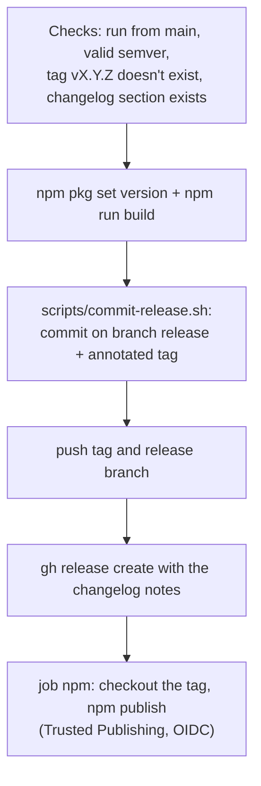
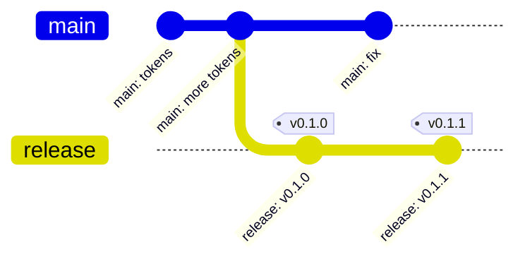

[Home](README.md) › Releases

# Releases

## How to make a release

1. On `main`, add a section `## [x.y.z] - YYYY-MM-DD` to `CHANGELOG.md` ([Keep a Changelog](https://keepachangelog.com/en/1.1.0/), [SemVer](https://semver.org/)).
2. GitHub → **Actions** → **Release** → **Run workflow** (branch `main`) → type `x.y.z`.

## What the pipeline does

`.github/workflows/release.yml`, started by hand (`workflow_dispatch`):



1. Checks the version is semver, the tag `vx.y.z` doesn't exist and the changelog has the section.
2. Builds `dist/` from `main` and writes the version in `package.json`.
3. Creates a commit on the `release` branch (`main`'s files + `dist/`) whose parent is the **previous release**, and tags it `vx.y.z`.
4. Creates the GitHub Release with the changelog notes.
5. Publishes `@kaamos-project/open-design-tokens` to npm (a separate job that can be re-run on its own).

A version with a suffix (`0.2.0-beta.1`) becomes a pre-release, and goes to the `next` tag on npm. A `concurrency` group prevents two releases from fighting over the `release` branch.

## The `release` branch



`commit-release.sh` builds each release commit with `git commit-tree`: the tree is `main` + `dist/` (added with `-f` because it's in `.gitignore`), the parent is the last release. So `release` is a line of snapshots, one per tag, with no merges.

Rules:

- `main` never contains generated files.
- Tags are never moved. If something is wrong, release a new version.

## npm Trusted Publishing

npm publishes with **Trusted Publishing** (OIDC): no token is stored in the repo. GitHub signs a short-lived token that says "I am `release.yml` of `kaamos-project/open-design-tokens`", npm verifies it and accepts the publish. npm also adds a *provenance* attestation (the package declares which commit and workflow built it). It needs npm ≥ 11.5.1, and no `registry-url` in `setup-node`, otherwise a fake `NODE_AUTH_TOKEN` takes precedence over OIDC.

### The first publish is manual

The trusted publisher is configured in the package settings, so the package must exist first:

1. Run release `0.1.0`: it creates the tag and the GitHub Release; the npm job sees the package doesn't exist and stops with a warning.
2. Locally:
   ```sh
   git fetch --tags && git checkout v0.1.0   # the commit with dist/
   npm login
   npm publish --access public
   git checkout main
   ```
3. On npmjs.com → package → **Settings → Trusted publishing → GitHub Actions**: organization `kaamos-project`, repository `open-design-tokens`, workflow `release.yml`, empty environment. The fields are case-sensitive.
4. A new trusted publisher must publish successfully **within 2 days** or it expires. Configure it when you're ready for the next release, not weeks before.
5. Recommended: in the same settings choose *Require two-factor authentication and disallow tokens*, so only the pipeline can publish.

## See also

- [Getting started](getting-started.md)
- [Decisions](decisions.md#generated-files-only-on-the-release-branch)
